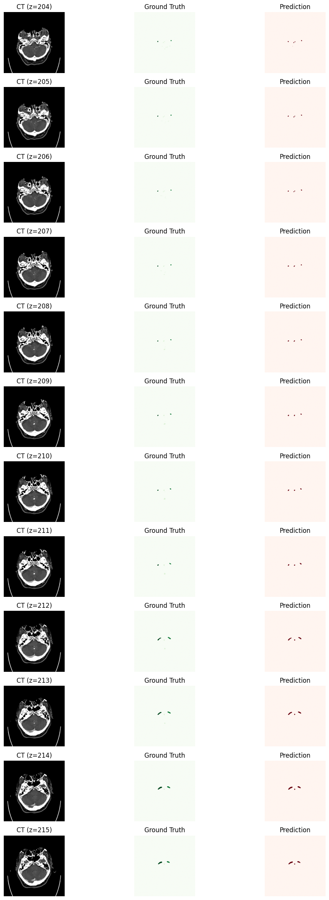

# Stage 1 – Circle of Willis (CoW) Localization & Cropping

Part of a two-stage pipeline for **intracranial aneurysm detection on CTA** (RSNA Intracranial Aneurysm Detection data).

> **Goal of the full project:** given a CTA scan, predict *whether* an aneurysm is present and, if so, *where*.

## Why Stage 1 exists

A full CTA volume is deep (hundreds of slices) and mostly irrelevant anatomy. Training a detector on whole scans is
costly and hard to learn from. Aneurysms sit on the cerebral arteries, so we first **find the Circle of Willis and crop
around it**. Stage 2 (aneurysm detection) will then train on small, vessel-focused crops.



*Axial slices. Left: CT. Middle: ground-truth vessel mask. Right: nnU-Net CoW prediction.*

## Pipeline

```
 DICOM series ──► 1 mm NIfTI + aneurysm mask ──► nnU-Net CoW prediction ──► crop around predicted vessels ──► Stage 2
   (RSNA)            03_preprocess_scans             04_predict_cow             05_crop_cow_region
```

The CoW model itself (steps 01–02) is trained once; steps 03–05 are run twice, once for the
`aneurysm` group and once for the `no_aneurysm` group (400 CTA scans each).

## Repository layout

```
stage1_cow_localization/
├── README.md
├── requirements.txt
├── assets/
│   └── prediction.png         s
├── notebooks/                         
└── src/
    ├── config.py                       # ALL paths and constants – edit this first
    ├── utils.py                        # nnU-Net env setup, file lookup, HU windowing
    ├── 01_prepare_cow_training_data.py # build nnU-Net Dataset001_CoW_Binary
    ├── 02_train_cow_nnunet.sh          # plan + preprocess + train (ResEnc-M, 3d_fullres, fold 0)
    ├── 03_preprocess_scans.py          # DICOM -> 1 mm NIfTI, aneurysm sphere masks, metadata
    ├── 04_predict_cow.py               # nnU-Net inference only (no cropping)
    ├── 05_crop_cow_region.py           # crop around predicted CoW + coverage stats
    ├── 06_visualize.py                 # CT/GT/prediction grid and crop overlays
    └── 07_evaluate_cow_dice.py         # Dice of CoW predictions vs. ground truth
```

## Setup

```bash
pip install -r requirements.txt
```
Edit the **PATHS** block in `src/config.py` (Kaggle paths are given in comments). Run all commands from the repo root.

## How to run

```bash
# --- once: train the CoW model -------------------------------------------
python src/01_prepare_cow_training_data.py
bash   src/02_train_cow_nnunet.sh

# --- for each group: aneurysm / no_aneurysm ------------------------------
python src/03_preprocess_scans.py --group aneurysm
python src/04_predict_cow.py      --group aneurysm
python src/05_crop_cow_region.py  --group aneurysm

python src/03_preprocess_scans.py --group no_aneurysm
python src/04_predict_cow.py      --group no_aneurysm
python src/05_crop_cow_region.py  --group no_aneurysm

# --- checks ---------------------------------------------------------------
python src/06_visualize.py cow  --series_id <uid> --z_start 205 --z_end 215
python src/06_visualize.py crop --group aneurysm --case 0
python src/07_evaluate_cow_dice.py --group aneurysm
```

## What each step does

| Step | Script | Input | Output |
|---|---|---|---|
| 1 | `01_prepare_cow_training_data.py` | CTA + 13-class vessel masks | nnU-Net dataset, vessels collapsed to one label (CoW = 1), raw HU kept |
| 2 | `02_train_cow_nnunet.sh` | nnU-Net dataset | trained model (`checkpoint_best.pth`) |
| 3 | `03_preprocess_scans.py` | RSNA DICOM series + `train.csv` + `train_localizers.csv` | `images_tr/`, `labels_tr/` (sphere r = 4 mm at each localizer), `json_files/`, `tracking_df.csv` |
| 4 | `04_predict_cow.py` | resampled scans | `predictions/<uid>.nii.gz` – binary CoW mask |
| 5 | `05_crop_cow_region.py` | scans + labels + predictions | `crops/images`, `crops/labels`, `crop_metadata.csv` |

### Preprocessing details (step 3)
- CTA only. Balanced case pool (830 positive / 830 negative, seed 42); first 400 of each group are used.
- Raw DICOM pixel values (no rescale slope/intercept), clipped to [-1024, 3000], resampled to **1 × 1 × 1 mm**.
- Slices sorted by `ImagePositionPatient` z; the most common in-plane size is kept.
- `slice_order` (inferior→superior or reverse) is stored in the metadata.

### Crop rule (step 5)
1. Find runs of consecutive axial slices containing predicted vessel voxels.
2. If the scan has **> 250 slices** and more than one run → keep the **last** run (chest→head scans: the CoW is on top).
   Otherwise keep the **longest** run.
3. z-range = run ± **15** slices; x/y = **96 × 96** window centred on the run's vessel bounding box.
4. No prediction at all → fixed *anatomical fallback* box (image centre, 45 % of height).
5. Crop intensities are windowed to [-100, 400] HU and scaled to [0, 1].

`crop_metadata.csv` records the rule used, crop coordinates and **`coverage_pct`** (share of aneurysm voxels that lie inside
the crop) so we can verify the crop does not cut aneurysms off.

## Results

| Group | Scans | Aneurysm fully inside crop | Notes |
|---|---|---|---|
| aneurysm | ~400 | _fill in from `crop_metadata.csv`_ (≈ 382 in earlier runs) | printed at the end of step 5 |
| no_aneurysm | ~400 | n/a (no aneurysm voxels) | |

## Mapping from the original notebooks

| Original notebook | Now |
|---|---|
| `locate-circle-of-willis.ipynb` | `01`, `02`, `06 cow`, `07` |
| `rsna-anyeurysm.ipynb`, `no-aneurysm.ipynb` | `03_preprocess_scans.py --group aneurysm / no_aneurysm` |
| `aneurysm-crop-02.ipynb`, `noaneurysm-crop02.ipynb` | `04_predict_cow.py` |
| `cropping-all-an-no-an-scans.ipynb` | `05_crop_cow_region.py` |

## Notes & things to double-check
- The no-aneurysm notebooks hard-coded `aneurysm_present = 1`; the new scripts read the real label from the metadata.
- Training scans for the CoW model were reoriented with `as_closest_canonical`, while inference scans keep the orientation
  written by SimpleITK. Predictions look good, but keep this in mind if a scan ever fails.
- Slice spacing is now the median of z-differences (identical to the old first-two-slices rule on uniformly spaced scans).
- Scripts were refactored from the notebooks; the crop script was smoke-tested on synthetic data, but re-run the full
  pipeline on your real data once to confirm the numbers match your earlier runs.

## Next: Stage 2
Train an aneurysm detector/segmenter on `crops/images` + `crops/labels` (positives and negatives from both groups).
